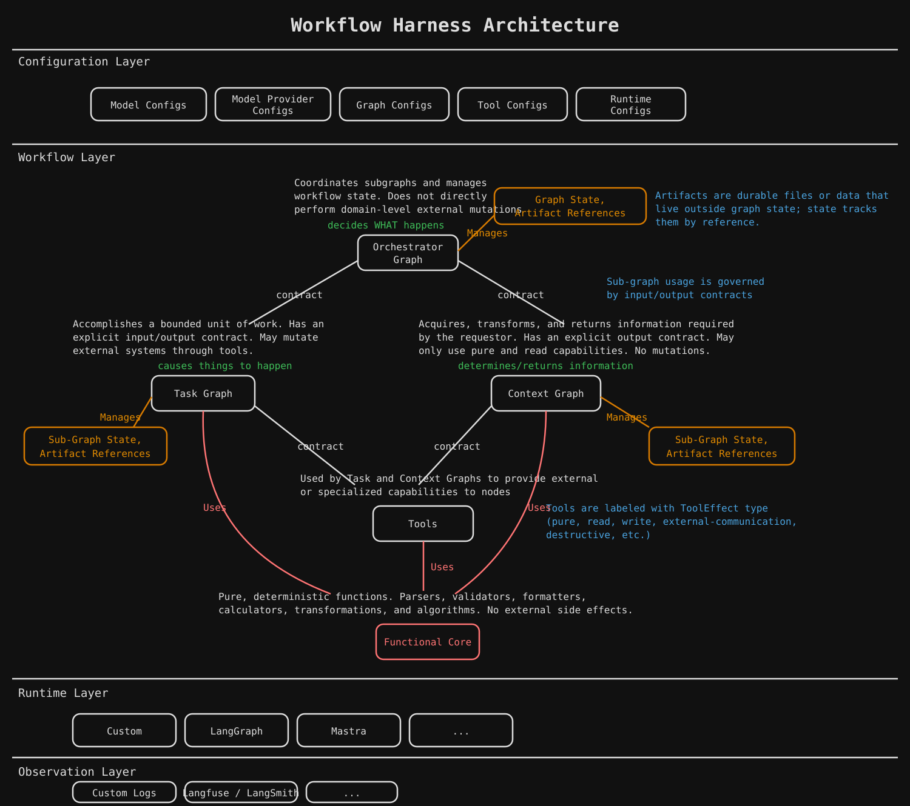

# Workflow Harness Architecture

A runtime- and language-independent architecture for building model-driven and deterministic AI workflows with clear responsibility, state, capability, and effect boundaries.

## Core model

The harness separates workflow behavior into a small set of architectural concepts:

- **Orchestrator Graphs** decide what happens and coordinate subgraphs.
- **Task Graphs** perform bounded work and may mutate external systems through authorized tools.
- **Context Graphs** acquire, transform, and return information using only pure and read capabilities.
- **Tools** expose external or specialized capabilities with explicit effect classifications.
- **Functional Core** contains pure, deterministic computation.
- **Graph State** tracks execution while durable files and evidence live outside state as **Artifacts** and are referenced from it.
- **Configuration** selects models, providers, graphs, tools, and runtime behavior.
- **Runtime Profiles** map the architecture onto a concrete execution framework without changing the harness semantics.

The architecture is intentionally runtime-agnostic. LangGraph, Temporal, DBOS, Mastra, custom runtimes, and other stacks can conform as long as they preserve the defined contracts and capability boundaries.

## Specifications

- [AI Workflow Harness Architecture Specification](docs/architecture/AI_HARNESS_ARCHITECTURE.md)
- [TypeScript / LangGraph Runtime Profile](docs/architecture/runtime-profiles/LANGGRAPH_TYPESCRIPT.md)

> **Orchestrators decide. Task Graphs perform work. Context Graphs inform. Tools provide capabilities. The Functional Core computes.**
